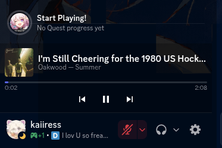

# AnyPlayerControls

A [Vencord](https://github.com/Vendicated/Vencord) userplugin for Vesktop/Discord that shows a small media player (album art, title, artist, progress bar, previous / play-pause / next) above your account panel, like SpotifyControls, but for **any media player on Linux that supports MPRIS**.



> ## ⚠️ Disclaimer: this is vibe-coded
> This plugin was written with AI assistance (Claude) and only lightly tested, on one setup (CachyOS + Vesktop + Feishin/Navidrome). Expect rough edges. It comes with **no warranty**, and I can't promise it will keep working after Discord, Vesktop or Vencord updates. Read the code before you run it, especially `native.ts`, which executes `playerctl` on your machine. Not affiliated with or endorsed by Vencord, Vesktop, Discord or Navidrome.

## Requirements

- Linux
- `playerctl` installed, and your player visible in `playerctl -l`
- Vesktop with a **custom Vencord build** (userplugins need Vencord built from source)
- Not a Flatpak Vesktop (the sandbox can't run `playerctl`)

## Install

```bash
# 1. dependencies (Arch shown; use your distro's equivalents)
sudo pacman -S playerctl git nodejs pnpm

# 2. get Vencord and add this plugin
git clone https://github.com/Vendicated/Vencord.git
cd Vencord
pnpm install --frozen-lockfile
mkdir -p src/userplugins
git clone https://github.com/kaiiress/AnyPlayerControls src/userplugins/AnyPlayerControls

# 3. build
pnpm build
```

Then:

1. In Vesktop: **Settings → Vesktop Settings**, set the Vencord location to the `Vencord/dist` folder, and fully restart Vesktop.
2. **Settings → Plugins**: enable **AnyPlayerControls** and **disable SpotifyControls** (both patch the same spot, so SpotifyControls will block this one).
3. In the plugin's settings, set **player** to the name shown by `playerctl -l` (e.g. `Feishin`), or leave it empty to use `playerctl`'s first active player.

To update later: `git pull` inside the plugin folder, then `pnpm build` in the Vencord folder and restart Vesktop.

## Settings

| Setting | Meaning |
| --- | --- |
| `player` | `playerctl` player name. Empty = first active player. |
| `pollMs` | How often to poll the player, in ms (minimum 500). |

## Known limitations

- Linux only (needs `playerctl` / D-Bus / MPRIS).
- No seek bar, volume or shuffle/repeat. Only previous, play/pause, next.
- Album art only loads when the player provides an `http(s)` image URL. `file://` art is not shown.
- With `player` empty, `playerctl` may pick a paused player over the one you're actually using. Set `player` to pin it.
- The patch targets Discord's current code. A Discord update can break it; look for "patch had no effect" in the devtools console (Ctrl+Shift+I).
- The widget hides itself when nothing is playing.

## Troubleshooting

- Run `playerctl -p <name> metadata` while playing. If it prints nothing, the player isn't exposing MPRIS.
- In the devtools console, run `await VencordNative.pluginHelpers.AnyPlayerControls.getState("<name>")`. It should return an object with the track info.
- Make sure SpotifyControls is disabled.

## License

GPL-3.0-or-later, the same license as Vencord. See `LICENSE`.
